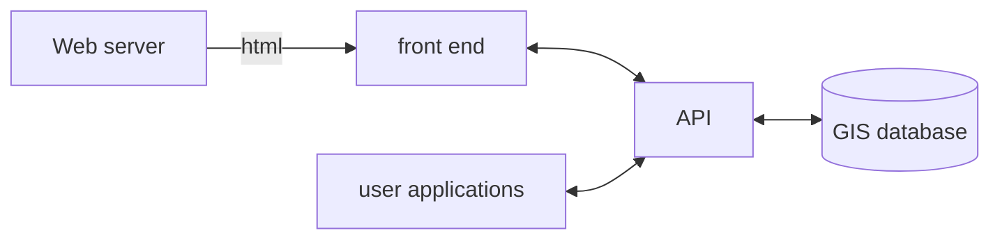

# 1



# 2
```mermaid
flowchart LR
 subgraph s1["back end"]
         cr("web server")
         D[("GIS database")]
  end
    A["user applications"] <-- API calls --> B["API"]
    B <-- API calls --> C["web front end"]
    B <-- GIS info --> D
    cr-->C
   ```

