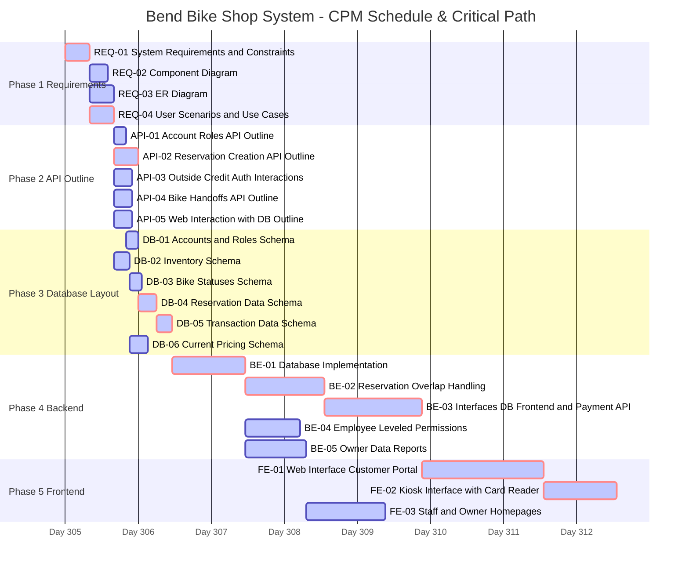

## WBS
* Bend Bike Shop System(100%)
    * frontend (40%)
        * Customer interface
            * homepage
            * accounts
            * reservations
            * inventory
        * employee interface 
            * reservation handoff
            * reservation checkin
            * bike condition report
        * manager interface
            * reservation adjustments
            * price adjustments
            * employee managing
        * owner interface
            * sales overveiw/preformance
    * backend(60%)
        * DataBase
        * Inventory allocation
            * bike statuses
            * reservation dates
                * overlap managment
        * Reservation API
        * Return API
        * Staff API
        * Payment API
            * communication with outisde payment portal
        * Kiosk interaction

## PERT
- Frontend: 114.7 hrs
- Backend: 169.0 hrs 
- Total: 283.7

## P90
- 303.5 hours

## CPM
| Task ID | Task Description | Duration (D) | Dependencies | ES | EF | LS | LF | Slack | Critical? |
| :--- | :--- | :---: | :--- | :---: | :---: | :---: | :---: | :---: | :---: |
| **REQ-01** | System Requirements & Constraints | 8 | None | 0 | 8 | 0 | 8 | 0 | Yes |
| **REQ-02** | Component Diagram | 6 | REQ-01 | 8 | 14 | 10 | 16 | 2 | No |
| **REQ-03** | ER Diagram | 8 | REQ-01 | 8 | 16 | 11 | 19 | 3 | No |
| **REQ-04** | User Scenarios & Use Cases | 8 | REQ-01 | 8 | 16 | 8 | 16 | 0 | Yes |
| **API-01** | Account Roles API Outline | 4 | REQ-04 | 16 | 20 | 27 | 31 | 11 | No |
| **API-02** | Reservation Creation API Outline | 8 | REQ-02, REQ-04 | 16 | 24 | 16 | 24 | 0 | Yes |
| **API-03** | Outside Credit Auth Interactions | 6 | REQ-02, REQ-04 | 16 | 22 | 24 | 30 | 8 | No |
| **API-04** | Bike Handoffs API Outline | 6 | REQ-04 | 16 | 22 | 131 | 137 | 115 | No |
| **API-05** | Web Interaction with DB Outline | 6 | REQ-02, REQ-03 | 16 | 22 | 79 | 85 | 63 | No |
| **DB-01** | Accounts & Roles Schema | 4 | REQ-03, API-01 | 20 | 24 | 31 | 35 | 11 | No |
| **DB-02** | Inventory Schema | 5 | REQ-03 | 16 | 21 | 19 | 24 | 3 | No |
| **DB-03** | Bike Statuses Schema | 4 | DB-02 | 21 | 25 | 31 | 35 | 10 | No |
| **DB-04** | Reservation Data Schema | 6 | DB-02, API-02 | 24 | 30 | 24 | 30 | 0 | Yes |
| **DB-05** | Transaction Data Schema | 5 | API-03, DB-04 | 30 | 35 | 30 | 35 | 0 | Yes |
| **DB-06** | Current Pricing Schema | 6 | DB-02 | 21 | 27 | 29 | 35 | 8 | No |
| **BE-01** | Database Implementation | 24 | DB-01, DB-03, DB-05, DB-06 | 35 | 59 | 35 | 59 | 0 | Yes |
| **BE-02** | Reservation Overlap Handling | 26 | BE-01, API-02 | 59 | 85 | 59 | 85 | 0 | Yes |
| **BE-03** | Interfaces: DB, Frontend & Payment API | 32 | BE-02, API-05 | 85 | 117 | 85 | 117 | 0 | Yes |
| **BE-04** | Employee Leveled Permissions | 18 | BE-01, API-04 | 59 | 77 | 137 | 155 | 78 | No |
| **BE-05** | Owner Data Reports | 20 | BE-01 | 59 | 79 | 135 | 155 | 76 | No |
| **FE-01** | Web Interface (Customer Portal) | 40 | BE-03 | 117 | 157 | 117 | 157 | 0 | Yes |
| **FE-02** | Kiosk Interface with Card Reader | 24 | FE-01 | 157 | 181 | 157 | 181 | 0 | Yes |
| **FE-03** | Employee, Manager, Owner Homepages | 26 | BE-04, BE-05 | 79 | 105 | 155 | 181 | 76 | No |

## Gantt
