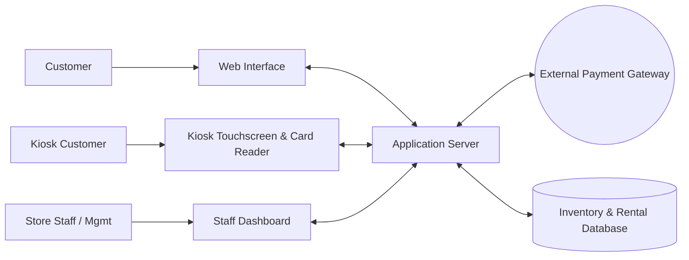

# Bend Bike Shop Software Technical Design Document
## overview
Bend bike shop offers bike rentals to the public and uses a software that lets customers reserve bikes ahead of time as well as in store. The system also has employee and admin sections. It is a web based application served to three front ends: the customer website, in-store kiosks, and the staff dashboard. All front ends share one application server and one database.
## actors
* Customer online: reserve different bikes and time slot based on online stock availability
* Customer kiosk: reserve different bikes now based on current stock
* Employee: Handles handoff of bikes from the system to customers and checks in bike returns, inspecting damages and evaluating timely returns.
* Manager: oversees employees and helps with overbooking due to damaged returns by reassigning reservations to other bikes (booking override)
* Owner: evaluates performance numbers (pricing, inventory and summary reports)
## Goals & Non-Goals
### Goals
* Avoid over/double booking
* easy online booking with confirmations
* tier based system access (customer, employee, manager, owner)
* management of inventory status (service, ready, checked out)
* dynamic price adjustments
* history and summary reports
### Non-Goals
* automatic stock reassignment when bikes are inoperable
* unattended bike handoffs
* automated cancellation compensation
## Constraints
* Bike handoffs must be facilitated by an employee
* reservations can be canceled 24 hours before the rental time
* late fee applied after 30 mins past the return time
* credit cards pre authorized when booking but no charges until the bikes are returned.
## Assumptions
* the online system has a 99.9 percent uptime
* third party payment authorizations
* web based
* kiosks have a persistent network connection to the application server
* rentals are either hourly or daily, priced per bike type
* customers are identified at the counter by name or phone number
## Non-Functional Requirements
| Requirement | Function |
|---|---|
| **booking confirmation** | Shows confirmation code and reservation overview after booking |
| **Card Reader** | card readers attached to in person kiosks |
| **kiosk idle timeout** | kiosk session prompts the user after 60 seconds and resets after timeout. Reset clears the cart, customer info and releases any held bikes |
| **Security** | Card data is never stored; only the gateway token and last 4 digits are kept. All traffic over HTTPS. Staff routes require authentication and role checks |
| **Concurrency** | Availability check and booking are one atomic database transaction so two users cannot book the same bike |
| **Auditability** | Overrides, price changes and status changes are logged with user and timestamp |
## component diagram 

| Component | Responsibility |
|---|---|
| **Web Interface** | Shows available bikes based on dates and sends that reservation and payment data to the server. Pages: home, inventory search (date + bike type filters), cart/checkout, confirmation |
| **Kiosk Interface** | In store interface for walk ins, same functionality as web interface but has a card reader attached. Starts at a "tap to rent a bike" welcome screen, then inventory, duration selection, cart, contact info, card swipe |
| **Staff Interface** | Different levels of access, manager (stock admin access), employee (returns and handoffs), owner (data reports). Screens: bike return, handoff, booking management (manager), inventory, pricing, reports |
| **Application server** | handles inventory allocation to the database, processes new reservations and talks to the payment gateway. Enforces role permissions and business rules (cancellation window, grace period, late fees) |
| **Payment Gateway** | processes billing requests through bank system, verifies card pre authorization and sends final billing |
| **Database** | stores current inventory, future reservations, staff accounts, and reservation/maintenance history |
## data model
| Entity | Key fields |
|---|---|
| **Bike** | id, type (e.g. performance), model, status (`ready`, `checked_out`, `service`), notes |
| **Customer** | id, name, phone, email |
| **Reservation** | id, confirmation_code, customer_id, start_time, end_time, source (`web`, `kiosk`), status (`reserved`, `checked_out`, `returned`, `canceled`), payment_token, preauth_id, total_charged |
| **ReservationBike** | reservation_id, bike_id (one reservation can hold multiple bikes) |
| **Staff** | id, name, credentials, role (`employee`, `manager`, `owner`) |
| **Price** | bike_type, hourly_rate, daily_rate, late_fee, effective_from |
| **AuditLog** | id, staff_id, action, reservation_id/bike_id, before/after, timestamp |

Maintenance and reservation history are kept by retaining old rows and AuditLog entries, not by deleting them.
## status rules
* Bike status flow: `ready` -> `checked_out` (employee handoff) -> `ready` (clean return) or `service` (damaged return). Managers can move a bike between `service` and `ready`.
* Only `ready` bikes with no overlapping reservation in the requested time range are shown as available.
* Reservation status flow: `reserved` -> `checked_out` -> `returned`. `reserved` -> `canceled` is allowed until 24 hours before start_time.
## key flows
### Online reservation
1. Customer selects date and filters by bike type; server returns available bikes.
2. Customer adds bikes to the reservation and goes to checkout.
3. Customer enters contact and card info; server requests a pre authorization from the gateway (no charge).
4. In one transaction the server re-checks availability, creates the reservation, and assigns the bikes. If a bike was taken in the meantime the booking fails and the customer is asked to pick again.
5. Confirmation page shows confirmation code and reservation overview; a confirmation is sent to the customer.
### Kiosk walk-in rental
1. Same as online reservation but start time is now and the card is read through the attached reader.
2. Gateway validates the card and places the pre authorization.
3. Kiosk shows the confirmation code and tells the customer to see an employee. Customer gives their name and the employee pulls the bikes and marks the reservation `checked_out` in the staff dashboard.
### Handoff
Employee looks up the reservation (confirmation code, name or phone), confirms the bikes, and marks it `checked_out`. Bikes become `checked_out`.
### Return
1. Employee searches by phone number (or code/name) in "bike return" and opens the rental details.
2. Employee inspects each bike and records condition (ok or damaged).
3. Server calculates the charge: base rental price, plus a late fee only if the bikes are more than 30 minutes past the return time (returns within the grace period have no late fee).
4. On "complete return" the server captures the final amount against the pre authorization through the gateway, sets the reservation to `returned`, and sends a receipt.
5. Undamaged bikes become `ready`; damaged bikes become `service`.
### Manager override (damaged bike)
1. Manager opens booking management and finds the affected reservation.
2. System lists replacement bikes of available status for that time range.
3. Manager reassigns the customer to other bikes and clicks "apply override".
4. Server updates reservation bikes and inventory in one transaction and writes an AuditLog entry. No reassignment happens automatically.
### Cancellation
Customer cancels using confirmation code. Allowed until 24 hours before start. The server releases the pre authorization and frees the bikes. Inside 24 hours the cancel request is rejected.
## role permissions
| Capability | Customer | Employee | Manager | Owner |
|---|---|---|---|---|
| Search, reserve, cancel own reservation | yes | | | |
| Handoff and returns | | yes | yes | |
| Booking override / reassign bikes | | | yes | |
| Update inventory status | | yes (return flow only) | yes | |
| Edit prices | | | yes | yes |
| View reports | | | yes (store) | yes |
## API outline
| Endpoint | Purpose | Access |
|---|---|---|
| `GET /bikes/available?start&end&type` | search availability | public |
| `POST /reservations` | create reservation + pre authorization | public / kiosk |
| `DELETE /reservations/{code}` | cancel (24 hour rule) | customer |
| `GET /reservations?phone|code|name` | find rentals | employee+ |
| `POST /reservations/{id}/handoff` | mark checked out | employee+ |
| `POST /reservations/{id}/return` | record condition, calculate and capture charge, send receipt | employee+ |
| `POST /reservations/{id}/override` | reassign bikes | manager |
| `PUT /bikes/{id}/status` | change status | manager |
| `PUT /prices` | update pricing | manager, owner |
| `GET /reports?range` | rental, revenue, utilization, maintenance summaries | manager, owner |
## error handling
* Card declined or pre authorization fails: no reservation is created; user sees the error and can retry.
* Gateway unavailable at return: reservation stays `checked_out`, the employee sees an error and can retry; the charge is not marked complete until the gateway confirms.
* Booking conflict: user is returned to search with updated availability.
* Kiosk timeout: session reset as described in the non-functional requirements.
## reporting
Owner and managers can view reports by date range: total rentals, revenue, late fees collected, utilization by bike type, and maintenance/out of service history. Reports are read from the database history tables.