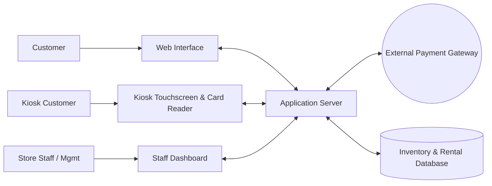

# Bend Bike Shop Software Technical Design Document
## overview
Bend bike shop offers bike rentals to the public and uses a software that lets customers reserve bikes ahead of time aswell as instore, the system also has employee and admin sections.
## actors
* Customer online: reserve different bikes and time slot based on online stock availablilty
* Customer kiosk: reserve different bikes now based on current stock
* Employee: Handles handoff of bikes from the system to customers and stocks in bike returns inspecting damages and evaluating timely returns.
* Manager: oversees employees and helps with overbooking due to damaged retunrs
* Owner: evaluates performance numbers and maybe helps if they're cool
## Goals & Non-Goals
### Goals
* Avoid over/double booking
* easy online booking with confirmations
* tier based system acess(customer, employee, manager, owner)
* managment of inventory status(service, ready, checked out)
* dynamic price adjustiments
* history and summary reports
### Non-Goals
* automatic stock reasignment when bikes are inoperable
* unattended bike handoffs
* automated cancellation compensation
## Constraints
* Bike handoffs must be facilitated by an employee
* reservations can be canceled 24 hours before the rental time
* late feed applied after 30 mins past the return time
* credit cards pre authorized when booking but no charges until the bikes are returned.
## Assumptions
* the online system has a 99.9 percent uptime
* third party payment authorizations
* web based
## Non-Functional Requirements
| Requirement | Function |
|---|---|
| **booking confirmation** | Shows confirmation code and reservaion overveiw after booking |
| **Card Reader** | card readers attatched to in person kiosks |
| **kiosk idle timeout** | kiosk session prompts the user after 60 seconds and resets after timeout |
## component diagram 

| Component | Responsibility |
|---|---|
| **Web Interface** | Shows availible bikes bases on dates and sends that reservation and payment data to the server|
| **Kiosk Interface** | In store interface for walk ins, same functionality as web interface but has a card reader attatched |
| **Staff Interface** |Different levels of access, manager(stock admin acess), employee(returns and handoffs), owner(data reports)  |
| **Application server** | handles inventory allocation to the database processes new reservations and talks to the payment gateway |
| **Payment Gateway** | processes billing requests through bank system, verifies card pre authorization and sends final billing|
| **Database** | stores current inventory, future reservations, staff accounts, and reservation/mantinence history|

