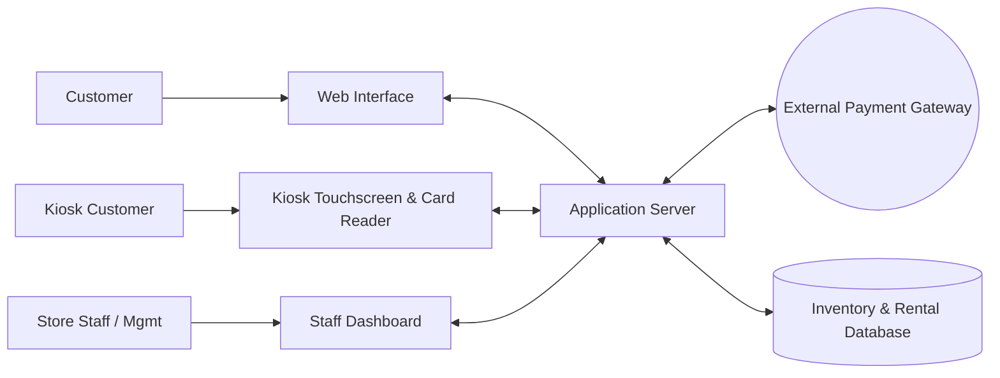
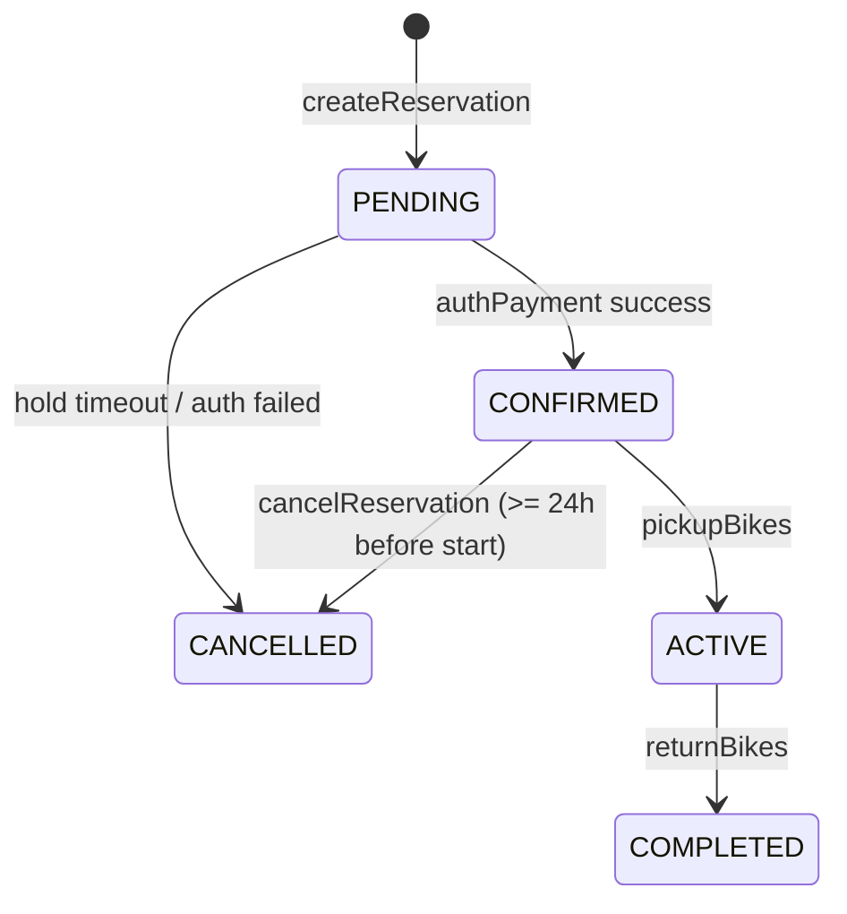
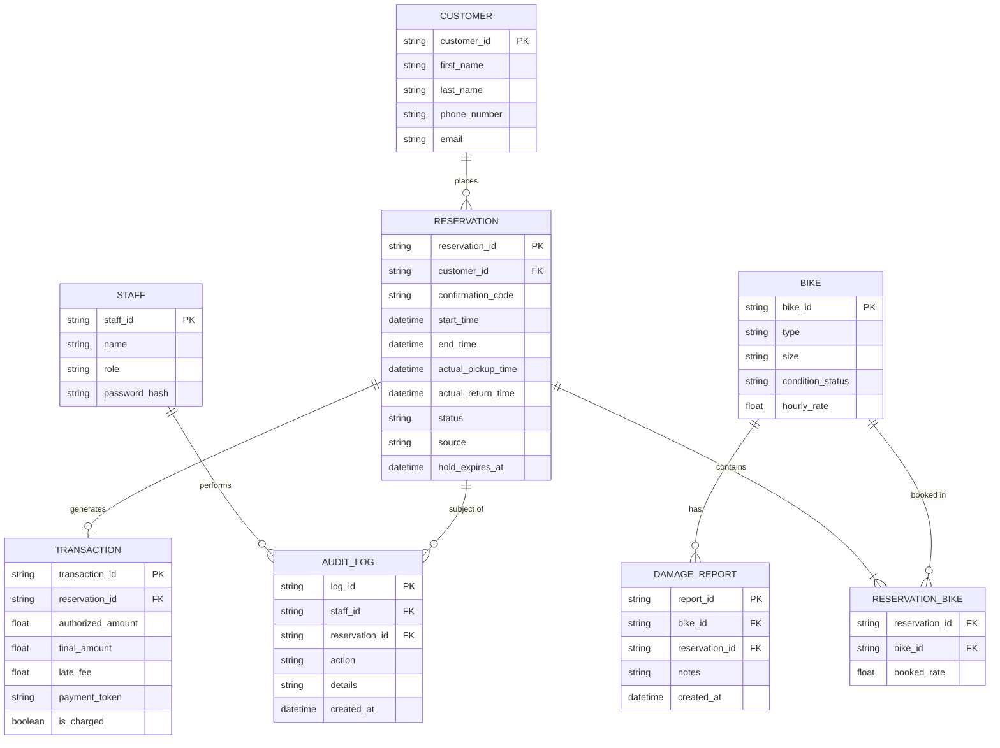
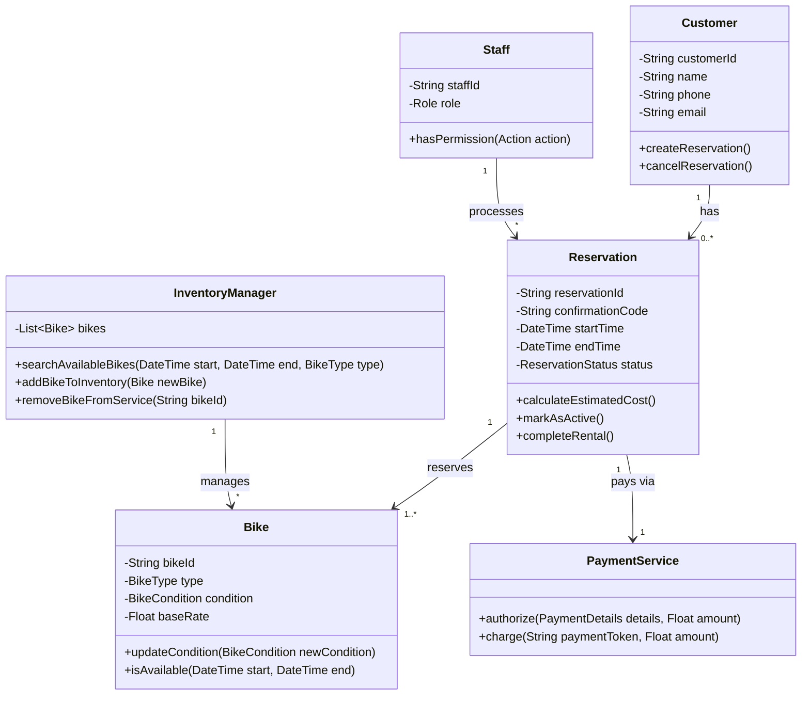

# Bend Bike Shop Software Technical Design Document
## overview
Bend bike shop offers bike rentals to the public and uses a software that lets customers reserve bikes ahead of time as well as in store. The system also has employee and admin sections. Customers can search for, reserve, and pre-pay for daily or hourly rentals through the web interface or in-store kiosks. Employees manage check-outs and returns, and managers/owners oversee pricing, inventory, and reports.

## actors
* Customer online: reserve different bikes and time slot based on online stock availability
* Customer kiosk: reserve different bikes now based on current stock
* Employee: Handles handoff of bikes from the system to customers and checks in bike returns, inspecting damages and evaluating timely returns.
* Manager: oversees employees, manages inventory and pricing, and resolves overbooking caused by damaged returns (manual reassignment and rate overrides)
* Owner: evaluates performance numbers through history and summary reports

## Goals & Non-Goals
### Goals
* Avoid over/double booking
* easy online booking with confirmations
* tier based system access (customer, employee, manager, owner)
* management of inventory status (service, ready, checked out)
* dynamic price adjustments
* history and summary reports
### Non-Goals
* automatic stock reassignment when bikes are inoperable (managers reassign manually)
* unattended bike handoffs
* automated cancellation compensation

## Constraints
* Bike handoffs must be facilitated by an employee
* reservations can be canceled up to 24 hours before the rental time
* late fee applied after 30 mins past the return time (grace period); returns within the grace period are not charged a late fee
* credit cards pre-authorized when booking but no charges until the bikes are returned.
* Reservations in `PENDING` state hold inventory for a limited time (default 15 minutes, configurable) and are released if payment is not authorized in that window.
* All money amounts are stored as decimals with 2 places in a single currency (USD) and all times are stored in UTC and displayed in store local time (America/Los_Angeles).

## Assumptions
* the online system has a 99.9 percent uptime
* third party payment authorizations
* web based
* the late fee amount and pending-hold timeout are configuration values set by a manager/owner, not hardcoded
* customers are identified by phone number and email, no customer login is required to book

## Non-Functional Requirements
| Requirement | Function |
|---|---|
| **booking confirmation** | Shows confirmation code and reservation overview after booking |
| **Card Reader** | card readers attached to in-person kiosks |
| **kiosk idle timeout** | kiosk session prompts the user after 60 seconds and resets after timeout, clearing all entered customer and card data |
| **Receipt** | after a completed return, a receipt is sent to the customer by email |
| **Card data security** | the system never stores card numbers; only the payment gateway token is stored (`payment_token`) |
| **Search performance** | inventory search returns within 2 seconds for typical queries |
| **Auditability** | rate overrides, reassignments, condition changes, and pickups/returns are logged with staff id and timestamp |

## Component Diagram

| Component | Responsibility |
|---|---|
| **Web Interface** | Shows available bikes based on dates and type filters, collects customer/payment info, and sends reservation and payment data to the server |
| **Kiosk Interface** | In store interface for walk-ins, same functionality as web interface but starts from a "tap to rent" welcome screen, uses a card reader attached to the kiosk, and starts at the current time with hourly/daily duration selection |
| **Staff Interface** | Different levels of access: employee (bike return lookup by phone number or confirmation code, pickups/handoffs, condition updates), manager (booking management, reassignment, rate overrides, stock admin), owner (reports) |
| **Application server** | Handles inventory allocation to the database, processes new reservations, enforces roles/permissions, calculates cost and late fees, sends receipts, and talks to the payment gateway |
| **Payment Gateway** | processes billing requests through bank system, verifies card pre-authorization and sends final billing |
| **Database** | stores current inventory, future reservations, staff accounts, and reservation/maintenance history |

## Access Control
| Capability | Customer | Employee | Manager | Owner |
|---|:-:|:-:|:-:|:-:|
| Search / reserve / cancel own reservation | ✔ | ✔ | ✔ | ✔ |
| Pickup and return processing | | ✔ | ✔ | ✔ |
| Update bike condition | | ✔ | ✔ | ✔ |
| Reassign bikes / override rates | | | ✔ | ✔ |
| Add/remove bikes, change base rates | | | ✔ | ✔ |
| View reports | | | | ✔ |

Staff authenticate with a username and password and receive a role-bearing session. Every staff-only interface checks the role server-side.

## Reservation Lifecycle

Bike `condition_status` values: `READY`, `CHECKED_OUT`, `NEEDS_REPAIR`, `OUT_OF_SERVICE`. A bike becomes `CHECKED_OUT` on pickup and returns to `READY` on a return with no damage flagged. Availability for future dates is determined by reservation overlap, not by `CHECKED_OUT`.

## ER Diagram

Notes:
* `RESERVATION_BIKE` is the join table, since a bike appears in many reservations over time. `booked_rate` is the per-bike rate snapshot taken at booking, so later price changes do not alter existing reservations.
* `source` is `WEB`, `KIOSK`, or `STAFF`. `role` is `EMPLOYEE`, `MANAGER`, or `OWNER`.
* `end_time` is the scheduled return time; late fee timing is measured against it. `actual_pickup_time` is set by `pickupBikes`.
* Indexes: `RESERVATION(customer_id)`, `RESERVATION(status, start_time)`, `CUSTOMER(phone_number)`, `RESERVATION_BIKE(bike_id)`, and a unique index on `confirmation_code`.

## Class Diagram

## Interfaces
Unless stated otherwise, each interface returns an error (with a reason code) when a "requires" condition is not met, and the database is left unchanged.

0. **searchAvailableBikes(start: DateTime, end: DateTime, type: BikeType, size: String) -> List< Bike >**
* purpose: inventory search used by the web and kiosk (and staff for lookups)
* requires: end must be after start, type and size are optional filters
* outcomes: returns bikes in `READY` condition with no `CONFIRMED`, `ACTIVE`, or unexpired `PENDING` reservation overlapping the time range
* guarantees: results never include `NEEDS_REPAIR` or `OUT_OF_SERVICE` bikes; each result includes the current rate and estimated cost for the range
* notes: results are advisory. Availability is only guaranteed once `createReservation` succeeds. Kiosk searches use start = now.

1. **createReservation(customerId: string, bikeIds: List< String >, startTime: DateTime, endTime: DateTime) -> String**
* purpose: create new reservation for a customer and disable the bikes from being rented for that timeframe
* requires: customerId must be assigned, bikeIds can't be Null or empty, startTime has to be in the future (kiosk uses current time), endTime must be after the startTime
* outcomes: a new reservation is created in the database that is marked `PENDING` with `hold_expires_at` set, and the current rate of each bike is saved as `booked_rate`
* guarantees: the return string is a unique reservationId and the bikes won't be double booked for the time requested. The overlap check and insert run in a single database transaction (serializable or row locking on the bikes), so concurrent requests cannot both succeed
* errors: `INVENTORY_UNAVAILABLE` if any bike is no longer free for the time range (no partial reservations are created)
* notes: no payment processing, just locking the inventory preventing double booking. A background job expires `PENDING` holds past `hold_expires_at` to `CANCELLED`.

2. **authPayment(reservationId: String, payment: paymentDetails) -> Bool**
* purpose: pre-authorize the customer's credit card to lock in the reservation
* requires: reservationId must point to an existing pending reservation whose hold has not expired
* outcomes: the payment gateway is contacted and iff successful the reservation status is changed to `CONFIRMED`, the `payment_token` and `authorized_amount` are stored in the transaction, and a confirmation code is generated
* guarantees: the card is authorized for the expected amount (sum of `booked_rate` x duration) not including possible late return fees, if the auth succeeds returns `true` otherwise `false`. A failed auth leaves the reservation `PENDING` until the hold expires so the customer can retry
* notes: same process for both web and kiosk. No charge is made. Gateway timeouts are retried up to 3 times before returning `false` with a payment error.

3. **pickupBikes(reservationId: String, employeeId: String) -> Bool**
* purpose: logs the handoff from staff to customer
* requires: reservationId must be `CONFIRMED` with a valid `payment_token`, employeeId must be associated to a staff member, all bikes must be `READY`
* outcomes: reservation status is `ACTIVE`, bikes are set to `CHECKED_OUT`, an audit log entry is written
* guarantees: the real pickup timestamp is recorded (`actual_pickup_time`) for late fee timing
* notes: only employees can successfully call this function. Walk-in kiosk customers are located by name or phone number or confirmation code at the counter.

4. **returnBikes(reservationId: String, returnTime: DateTime, damages: List< String >) -> float**
* purpose: process the return of the bikes, calculate cost, and trigger the credit card charge
* requires: reservationId status must be `ACTIVE`, caller must be employee or higher
* outcomes: reservation status is `COMPLETED`, final amount charged, receipt emailed, damage is flagged
* guarantees: returns the final charge. If returnTime is more than 30 mins past `end_time` the late fee is applied (`late_fee` is calculated from the time past `end_time`); a return inside the grace period has no late fee. Each bike with a damage entry gets a `DAMAGE_REPORT` and `updateBikeCondition` is called for it; all other bikes are set to `READY`
* errors: if the charge fails, the reservation stays `ACTIVE`, the error is shown to the employee, and the charge can be retried or taken in store
* notes: all bikes in the reservation are returned together; a customer returning 2 bikes from one reservation is a single call. Lookup before the call is done with `findReservations`.

5. **updateBikeCondition(bikeId: String, condition: bikeCondition, notes: String) -> bool**
* purpose: lets staff mark a bike as damaged or repaired updating its future availability
* requires: bikeId must exist in DB
* outcomes: the bike's condition is updated. If it's set to `NEEDS_REPAIR` or `OUT_OF_SERVICE`, it is removed from the inventory
* guarantees: future inventory searches will adapt depending on the bike's condition, this function returns true when successful
* notes: if a bike is marked out of service while tied to a future reservation, that reservation is flagged and a manager is alerted on the dashboard to handle the conflict (no automatic reassignment)

6. **overrideRate(reservationId: String, managerId: String, newRate: Float, reason: String) -> Bool**
* purpose: lets managers adjust the cost of reservations
* requires: managerId must be associated with a manager or owner, reservationId must be active or pending, reason is not empty
* outcomes: current rate for rent is overwritten with new rate, reason is logged
* guarantees: the system will use newRate when charging
* notes: standard employees can't use this function.

7. **findReservations(phone: String, confirmationCode: String, name: String) -> List< Reservation >**
* purpose: lets staff find a rental at return or pickup (e.g. by customer phone number)
* requires: caller must be staff, at least one search field is provided
* outcomes: returns matching reservations with customer details, bikes, times, and status
* guarantees: results are read-only and don't change state

8. **reassignBikes(reservationId: String, managerId: String, oldBikeId: String, newBikeId: String, reason: String) -> Bool**
* purpose: lets managers move a reservation to a different bike when the original is unavailable (damaged or out of service); used by the "apply override" action
* requires: managerId must be associated with a manager or owner, reservation must be `PENDING`, `CONFIRMED`, or `ACTIVE`, newBikeId must be `READY` and free for the reservation's time range
* outcomes: the `RESERVATION_BIKE` row is switched to newBikeId, inventory is updated, the change is audit logged
* guarantees: invariants 1 and 4 still hold after the change; the reservation keeps its payment token, and the new bike's rate is used unless overridden by `overrideRate`
* notes: manual action only (no automatic reassignment, see Non-Goals). The customer is notified of the change by the employee at the desk.

9. **cancelReservation(reservationId: String, customerId: String) -> Bool**
* purpose: lets a customer cancel an upcoming reservation
* requires: reservation must be `PENDING` or `CONFIRMED` and owned by customerId, current time must be at least 24 hours before `start_time`
* outcomes: reservation status is `CANCELLED`, the bikes become available for that time range, and the card authorization is voided
* guarantees: no charge is made. Returns `false` if it is inside the 24-hour window
* notes: staff can cancel on behalf of a customer; a manager can cancel inside the window

10. **getReport(ownerId: String, start: DateTime, end: DateTime, reportType: String) -> Report**
* purpose: history and summary reports (revenue, utilization per bike/type, late returns, damage/maintenance history)
* requires: ownerId must be associated with an owner (or manager for inventory/maintenance reports)
* outcomes: returns aggregated data for the range
* guarantees: read-only, does not affect any rental state

## Invariants
1. one bike can't have more than one confirmed or active reservation associated with itself at a single point in time.
2. A reservation must have a valid paymentToken associated to itself and be in a confirmed state before pickupBikes can be called.
3. the final transaction amount charged for a completed reservation must equal the sum of the booked rates for the rental duration, unless the late fee applies or a manager override was logged
4. a bike that is marked with `NEEDS_REPAIR` or `OUT_OF_SERVICE` can't be assigned to a `PENDING` or `CONFIRMED` reservation
5. a card is never charged before `returnBikes` completes, and a transaction is charged at most once (`is_charged` is checked before any charge)
6. every staff-only action (pickup, return, condition change, reassignment, override) writes an audit log entry with the staff id

## Failure Modes
Failure Mode | Cause | Impact  | Resolution |
| :--- | :--- | :--- | :--- |
| Payment Gateway Timeout | API service is unreachable or has a high response latency | reservation unconfirmed, Web/Kiosk waits or shows payment error. | Displays error, system retries 3 times. Employees can process payment in store. The `PENDING` hold is kept until it expires so the customer can retry. |
| Kiosk Card Reader Failure | Hardware malfunction | Customers cannot pay at the kiosk. | Kiosk displays "swipe Unavailable" and asks the user to type the card manually or approach the employee counter. |
| Double Booking | Two users reserve the exact same bike for the same time slot simultaneously. | One bike assigned to two different reservations | The `createReservation` references the database in a single transaction; the first request succeeds and the second receives an "Inventory no longer available" error and must rebook. |
| Rental Forgotten | Employee accepts a returned bike but forgets to process `returnBikes` | The customer accrues late fees incorrectly and the bike remains unavailable for future inventory. | System checks for overdue returns and notifies the manager about unreturned items on the dashboard. Staff can enter the actual return time when processing so the late fee uses the real handback time. |
| Bike Damaged With Future Booking | Bike returned damaged and marked out of service while tied to a later reservation | A customer arrives for a bike that is not available | The reservation is flagged and the manager is alerted. The manager uses `reassignBikes` (and `overrideRate` if needed) to move the customer to another bike. |
| Charge Fails At Return | Authorization expired or card declined at `returnBikes` | Final amount not collected | The reservation stays `ACTIVE`, the employee is shown the error and can retry or collect payment in store. The failure is logged. |
| Kiosk Idle Session | Customer walks away mid-checkout | Entered personal and card data left on screen; bikes held | After 60 seconds a prompt appears; on timeout the session is cleared and the `PENDING` hold expires. |
| Pending Hold Expired | Customer takes longer than the hold time to pay | Reservation cancelled before payment | The customer is told the hold expired and must search again. The bikes are released to inventory. |