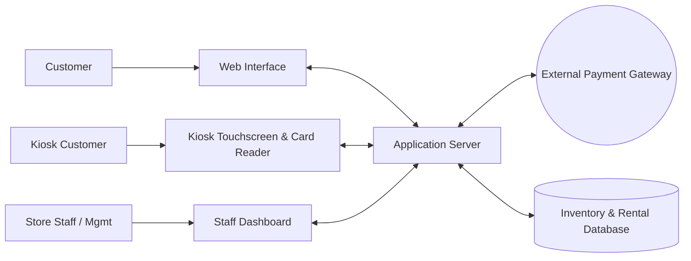
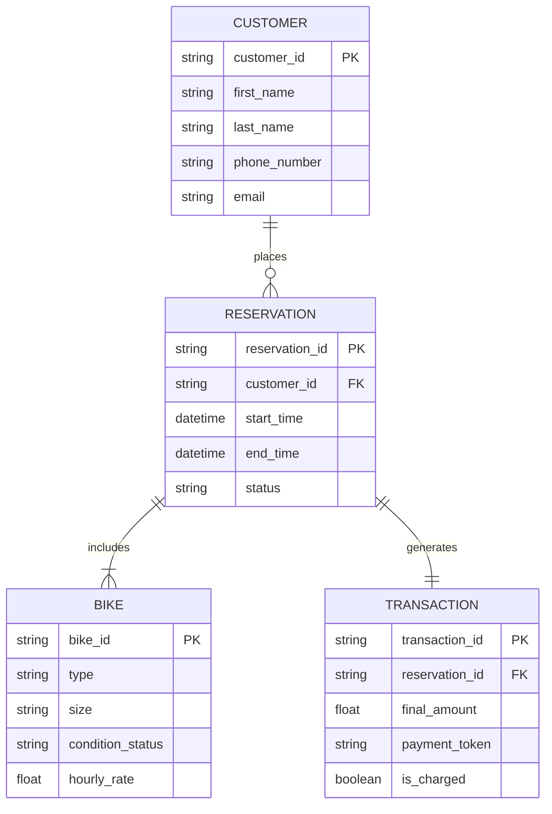
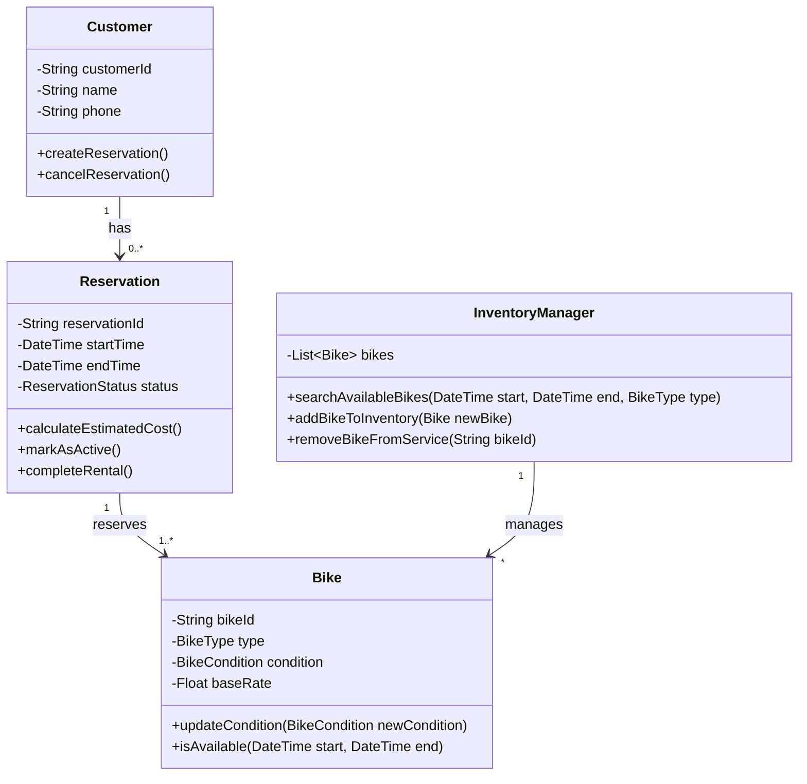

# Bend Bike Shop Software Technical Design Document
## overview
Bend bike shop offers bike rentals to the public and uses a software that lets customers reserve bikes ahead of time aswell as instore, the system also has employee and admin sections.
## actors
* Customer online: reserve different bikes and time slot based on online stock availablilty
* Customer kiosk: reserve different bikes now based on current stock
* Employee: Handles handoff of bikes from the system to customers and stocks in bike returns inspecting damages and evaluating timely returns.
* Manager: oversees employees and helps with overbooking due to damaged retunrs
* Owner: evaluates performance numbers and maybe helps if they're cool
## Goals & Non-Goals
### Goals
* Avoid over/double booking
* easy online booking with confirmations
* tier based system acess(customer, employee, manager, owner)
* managment of inventory status(service, ready, checked out)
* dynamic price adjustiments
* history and summary reports
### Non-Goals
* automatic stock reasignment when bikes are inoperable
* unattended bike handoffs
* automated cancellation compensation
## Constraints
* Bike handoffs must be facilitated by an employee
* reservations can be canceled 24 hours before the rental time
* late feed applied after 30 mins past the return time
* credit cards pre authorized when booking but no charges until the bikes are returned.
## Assumptions
* the online system has a 99.9 percent uptime
* third party payment authorizations
* web based
## Non-Functional Requirements
| Requirement | Function |
|---|---|
| **booking confirmation** | Shows confirmation code and reservaion overveiw after booking |
| **Card Reader** | card readers attatched to in person kiosks |
| **kiosk idle timeout** | kiosk session prompts the user after 60 seconds and resets after timeout |
## Component Diagram 

| Component | Responsibility |
|---|---|
| **Web Interface** | Shows availible bikes bases on dates and sends that reservation and payment data to the server|
| **Kiosk Interface** | In store interface for walk ins, same functionality as web interface but has a card reader attatched |
| **Staff Interface** |Different levels of access, manager(stock admin acess), employee(returns and handoffs), owner(data reports)  |
| **Application server** | handles inventory allocation to the database processes new reservations and talks to the payment gateway |
| **Payment Gateway** | processes billing requests through bank system, verifies card pre authorization and sends final billing|
| **Database** | stores current inventory, future reservations, staff accounts, and reservation/mantinence history|

## ER Diagram


## Class Diagam

## Interfaces
1. **createReservation(customerId: string,bikeIds: List < String >, startTime: DateTime, endTime) -> String**
* Purpose: create new reservation for a customer and disables the bikes from being rented for that timeframe
* Requires: customerId must be assigned, bikeIds cant be Null, startTime has to be in the future, endtime must be after the startTime
* outcomes: a new reservation is created in the database that is marked pending
* guarantees: the return string is a unique reservationId and the bikes wont be double booked for the time requested
* notes: no payment processing just locking the inventory preventing double booking

2. **authPayment(reservationId: String, payment: paymentDetails) -> Bool**
* purpose: pre authorize the customers credit card to lock in the reservation
* requires: reservationId must point to an existing pending reservaation
* outcomes: The payment gateway is contacted and iff successfull the reservation status is changed to confirmed
* guaruntees: the card is authorized for the expected amount not including possible late return fees, if the auth succeds returns ```true``` otherwise ```false```
* notes: same process for both web and kiosk

3. **pickupBikes(reservationId: String, employeeId: String) -> Bool**
* purpose:logs the handoff from staff to customer
* requires: reservationId must be confirmed, employeeId must be associated to a staff member
* outcomes: reservation status is active
* guaruntees: the real pickup timestamp is recorded for late fee timing
* notes: only employees can successfully call this function

4. **returnBikes( reservationId: String, returnTime: DateTime, damages: List< String >) -> float**
* purpose: process the return of the bikes calculates cost and triggers credit card charge
* requires: reservationId status must be active
* outcomes: reservationId status is completed, final amount charged, damage is flagged
* guaruntees: returns the final charge, if returnTime is more than 30 mins past end time the late fee is applied
* notes:

5. **updateBikeCondition( bikeId: String, condition: bikeCondition, notes: String)-> bool**
* purpose: lets staff mark a bike as damaged or repaired updating its future availability
* requires: bikeId must exist in DB
* outcomes: the bikes condition is updated if its set to ```NEEDS_REPAIR``` or ```OUT_OF_SERVICE```, its removed from the inventory
* guaruntees: future inventory searches will adapt depedning on bikes condition, this function returns true when successfull
* notes: if a bike is marked out of service while tied to a future reservation a manager is alerted to handle the conflict

6. **overrideRate(reservationId: String, managerId: String, newRate: Float, reason: String) -> Bool**
* purpose: lets managers adjust the cost of reservations
* requires: managerId must be associated with a manager or owner, reservationId must be active or pending.
* outcomes: current rate for rent is overwritter with new rate, reason is logged
* guaruntees: the system will use newRate when charging
* notes:standard employees cant use this function.

## Invariants
1. one bike cant be have more than one confirmed or active reservation associated with itself at a single point in time.
2. A reservation must have a valid paymentToken associated to itself and be in a confirmed state before pickupBikes can be called.
3. the final transaction amount charged for a completed reservation must equal the sum of the booked rate unless the late fee applies
4. a bike that is marked with ```NEEDS_REPAIR``` or ```OUT_OF_SERVICE``` cant be assigned to a ```PENDING``` or ```CONFIRMED``` reservation

## Failure Modes
Failure Mode | Cause | Impact  | Resolution |
| :--- | :--- | :--- | :--- |
| Payment Gateway Timeout | API service is unreachable or has a high response latency | reservation unconfirmed, Web/Kiosk waits or shows payment error. | Displays error, system retries 3 times. employees can process payment instore |
| Kiosk Card Reader Failure | Hardware malfunction | Customers cannot pay at the kiosk. | Kiosk displays "swipe Unavailable" and asks the user to type the card manually or approach the employee counter. |
| Double Booking | Two users reserve the exact same bike for the same time slot simultaneously. | One bike  assigned to two different reservations | The `createReservation` refrences the database and the first request succeeds and the second receives an "Inventory no longer available" error and must rebook. |
| Rental Forgotten| Employee  accepts a returned bike but forgets to process `returnBikes` | The customer accues late fees incorrectly and the bike remains unavailable for future inventory. | System checks for overdue returns and notifies the manager about unreturned items on the dashboard |